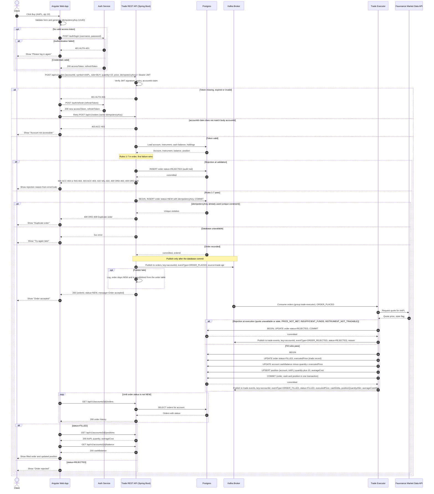

# Trade capture sequence (corrected)

## Notes

- Endpoint, request fields and error codes follow `shared/contracts/trade-api.yaml` (`placeOrder`). The idempotency key is a body field, not a header.
- Topics, key, event types and `source` follow `shared/contracts/kafka-topics.md`: `orders` carries `ORDER_PLACED`, and `trade-events` carries `ORDER_FILLED` and `ORDER_REJECTED`.
- The order is committed as `NEW` before `ORDER_PLACED` is published and before the Trade Executor runs (BR-06). A rejected order is also recorded.
- The order status and `executedPrice` (the trade record), the cash balance and the position update in one transaction (BR-09).
- The Angular UI never talks to Kafka. It polls the account endpoints for the outcome.
- The contract has no `Trade`, `OrderEvent` or `Settlement` table. The order row is the audit trail and the trade record.
- The contract uses status `NEW`, so this diagram uses `NEW` where the class model uses `PLACED` and `ACCEPTED`. Align `OrderStatus` in the class model.
- A request for an account that does not exist (`ACC-404`) has no account to record the rejected order against.
